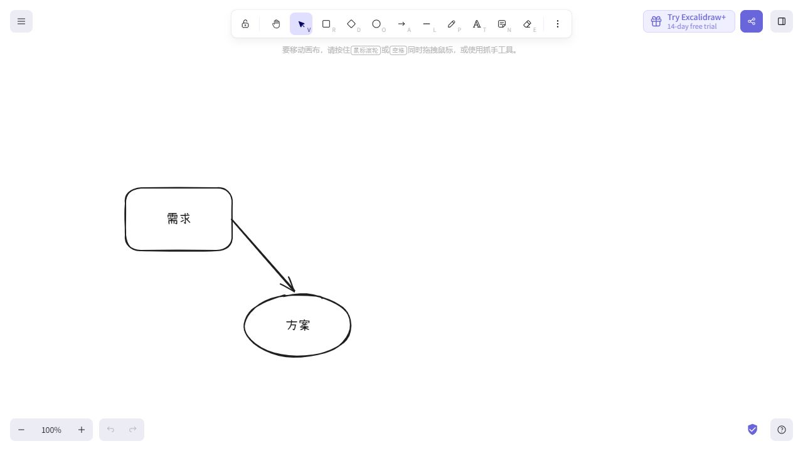
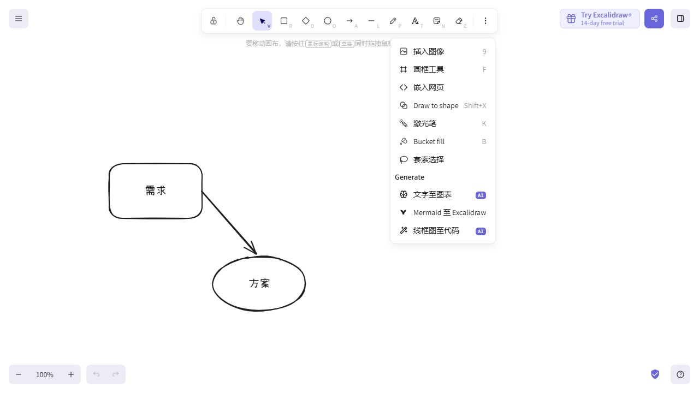
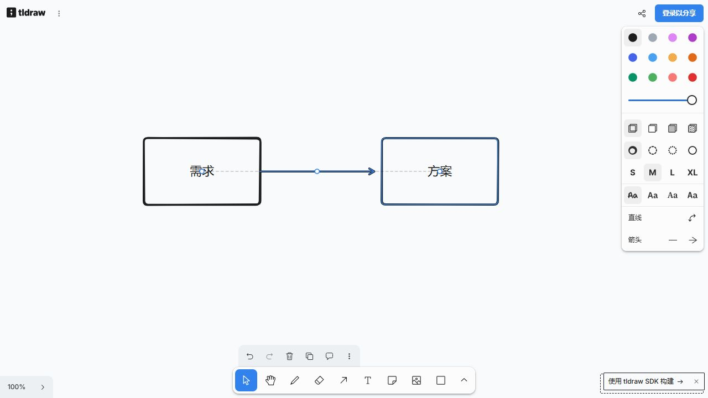

# 产品图片与 GUI 借鉴图册

研究日期：2026-10-19。配套阅读：[研究结论与选型建议](research-report.md)。这里展示真实产品界面；不是 DrawingBoard 新草图，也没有用 AI 重绘竞品图片。

共收录 **15 个产品/项目的图片入口**。其中 11 个目标已在本轮查看实际画面；Concepts 图片加载失败，Lorien、gInk、Microsoft Whiteboard 仅核实官方来源入口。远程图片依赖原站网络，未另行下载保存。Excalidraw 与 tldraw 的操作截图已保存在项目，离线可看。

“查看官方图片”与“运行软件”分开：本轮只实际操作了 Excalidraw 和 tldraw 网页版的基础绘制，其他产品没有安装或完成交互验收。来源笔记记录了各子任务当时的取证状态，本图册补充后续统一视觉核看结果。

## 1. Excalidraw：优先验证的画布底座

**图片状态：本轮真实网页操作截图，1280×720。** 在 [excalidraw.com](https://excalidraw.com/) 用普通工具绘制两个对象、中文文字和箭头。截图证明基础工作区与这些操作可用，不证明按住规整、中文输入法组合过程或 Windows 本地保存已经验证。

值得看：上方浮动工具条、宽敞画布、文件入口与绘图工具分离。对 DrawingBoard，可复用成熟对象编辑能力，把常用入口精简到已确认工具集。

**补充状态：实际打开 More tools 菜单。** 当前公开站点可见 Draw to shape。只核实入口，没有以该截图声称已经跑通本产品的“停顿后规整”。网页部署版本未与源码提交逐字节对应。

[源码与差异分析](source-notes-canvas.md) · [GitHub](https://github.com/excalidraw/excalidraw)

## 2. tldraw：工具扩展架构和选中状态

**图片状态：本轮真实网页操作截图，1280×720。** 来源 [tldraw.com](https://www.tldraw.com/)。用普通工具绘制两个带文字矩形和箭头，当前箭头被选中。

值得看：内容保持简单；选择反馈、端点与属性形成对应关系。它的 SDK 工具状态机值得深入参考，但当前许可证有生产使用限制，不能因网页可免费试用就推定 SDK 可以自由商用。我们的属性入口仍以按需、就近呈现为目标，不必照搬固定面板。

[源码及许可证说明](source-notes-canvas.md) · [GitHub](https://github.com/tldraw/tldraw)

## 3. FigJam：操作分层最清楚的参考

**图片状态：官方网页版帮助配图，已查看画面，原图 2796×1712。** 紫色分区标注来自官方，不是本研究添加。来源：[Explore FigJam files](https://help.figma.com/hc/en-us/articles/15300412458647-Explore-FigJam-files)。

值得看：文件控制、画布工具、协作入口各占一个区域，工作区主体很干净。DrawingBoard 借鉴的是职责分层；我们已确认的工具条仍放上方，不因为竞品在底部就改动基线。头像、投票、音乐与协作等入口不进入首版。

## 4. Balsamiq：页面布局与选中后属性

**图片状态：当前官方编辑器帮助图，已查看画面，原图 2300×1344。** 来源：[Editor overview](https://balsamiq.com/support/creating-and-editing/editor-overview/)。不能把这张现行编辑器图标成旧 Desktop 实机。

值得看：选中对象附近出现属性工具，页面草图由少量清晰元素组成。建议借鉴“选中什么就展示什么”，避免默认常驻完整属性表。图中的 AI/原型生成入口不在我们的范围内。

可补看：[当前 Draft / Sketch / Presentation 风格对比图](https://balsamiq.com/assets/product/editor/project-style-example.png)，来源 [Project properties](https://balsamiq.com/support/creating-and-editing/editor-overview/project-properties/)。该补充图本轮只核实来源，没有逐像素查看；不要沿用旧版风格名称推断现行产品。

## 5. Miro：把命名区域接到展示流程

**图片状态：官方局部面板图，已查看画面，原图 844×754。** 来源：[Frames](https://help.miro.com/hc/en-us/articles/360018261813-Frames)。这是 Frames 面板及菜单，不是完整主窗口。

值得看：同一面板连接区域缩略图、列表组织和 Present。DrawingBoard 的命名区域可以贯通定位、展示和导出；普通矩形不应因此自动成为区域。顺序播放、多页 PDF、讲者备注不是这次研究自动增加的需求。

## 6. Allume（原 Muse）：安静的画布与混合内容

**图片状态：官方 Mac 浅色工作区，已查看画面，原图 2824×1844；资源路径标 v4.0。** 来源：[Allume 官网](https://allume.com/)。这是 Apple 平台产品，不是 Windows 截图。

值得看：偏纸面的底色、克制的边界、文字/图片/文档自然共存，工具没有抢过内容。可作为我们的视觉气质参考，但不照搬嵌套画板、平台专属手势或材质效果。

## 7. Concepts：按住规整的直接产品先例

**图片状态：从官方手册提取，浏览器加载失败，未完成视觉核看。** 来源：[Workspace](https://concepts.app/en/manual/workspace)。保留直链供网络恢复后查看，不以这张未加载图推断具体像素样式。

操作参考更有价值：[Draw & Hold 设置图](https://cdn.tophatch.com/cms/uploads/image97_1776182277034.png)与 [Settings 正文](https://concepts.app/en/manual/settings)。官方描述在最后一笔末尾按住触发识别，并可调整触发时长。其多笔识别、按住后缩放旋转不等于我们已经确认的单笔规则；本轮没有确认 Windows 版本与统一手册的功能完全一致。

另有官方 [Windows 标题栏局部图](https://cdn.tophatch.com/cms/uploads/image186_1776182217841.png)，只作为来源入口。

## 8. Scapple：双击落字、自由摆放

**图片状态：官方示例，已查看画面，原图 1400×946。** 来源：[Scapple overview](https://www.literatureandlatte.com/scapple/overview)。画面可见 macOS 窗口控制，因此这里按 Mac 示例标注；官网另提供 Windows 版，不能把两者混称。

值得看：双击就能输入，文字不必先塞进模板，画布也不需要常驻复杂面板。仅借鉴输入与简洁程度，不照搬“拖节点到另一个节点上连线”，以免破坏我们拖边框移动的规则。

## 9. Heptabase：内容找回与空间上下文

**图片状态：官方帮助图，已查看画面，原图 3456×2160。** 来源：[Fundamental elements](https://wiki.heptabase.com/fundamental-elements)。图片没有单独证明当前 Windows 版本的全部界面。

值得看：左侧空间关系与右侧可检索卡片同时出现。对 DrawingBoard，借鉴“找到内容之后还能回到原来的空间位置”；卡片数据库和长期打开的大侧栏会增加负担，暂不采用。

## 10. Penlight：Windows 轻量外壳的近邻

**图片状态：官方仓库固定提交中的白板图，已查看画面，原图 1920×1032。** 来源：[Penlight 仓库](https://github.com/Ramonvdo/penlight)。不是本轮安装运行截图。

值得看：小型画布列表和紧凑工具条，功能入口少。源码中的托盘、全局快捷键、每画布文件和相机恢复值得拆开借鉴。项目年轻，不能因图片很接近就直接判定成熟可靠；它的屏幕覆盖层与我们的普通窗口也不同。

[Windows 源码笔记](source-notes-windows.md)

## 11. Rnote：笔迹、图像和形状共存

**图片状态：官方固定提交配图，已查看画面，原图 1070×817。** 来源：[Rnote README](https://github.com/flxzt/rnote/blob/9b2ccabe9956c548e51bdd5ffa0ec08d0ad0fdca/README.md)。不能称为 Windows 本机截图。

值得看：笔迹与图片混排、浮动工具收纳。实现上更值得借的是形状几何、可见轮廓和命中区分开；它的 Shaper 是预选图形工具，不能从截图推断为自动识别智能笔。GPL 许可也限制直接复制到不同许可产品中的方式。

## 12. Xournal++：识别与保留原迹的实现参考

**图片状态：官方 README 标注的 Windows 10 示例，已查看画面，原图 1280×800。** 来源：[Xournal++ README](https://github.com/xournalpp/xournalpp/blob/7e25f4db8fb4a4f7b29ad64285f4f0fd7f6c98f2/README.md)。图片较旧，不能按源码核验日期称为 2026 年最新 GUI。

值得借鉴的是源码中的识别流程与撤销时保存 original/recognized 两份对象，不是这张界面里的工具栏密度。它的输出仍是笔迹对象，与我们的参数化图形、绑定文字、连接关系有距离。

[算法与许可笔记](source-notes-gestures.md)

## 13–15. 辅助目标：有官方图源，未逐图核看

### Lorien：笔迹优先的无限画布

[官方仓库](https://github.com/mbrlabs/Lorien)。固定提交图片路径已核实。研究重点为无干扰模式和笔迹空间；未确认它具备本项目的语义连接或停顿识别。

### gInk：临时绘制与工具收起

[官方仓库](https://github.com/geovens/gInk)。固定提交图片路径已核实。研究托盘唤出、预设笔和退出流程，界面年代感不能作为当前视觉方向依据。

### Microsoft Whiteboard：Teams 中的白板

[官方来源](https://support.microsoft.com/en-us/whiteboard/retirement-standalone-microsoft-whiteboard-apps)。该图是 Teams 内使用场景，不是独立 Windows 客户端。官方已宣布独立 Windows/iOS/Android 应用于 2026-10-16 退休，当前适合参考局部交互，不能推荐它作为仍可长期依赖的独立桌面形态。

## 不应伪造“产品图片”的模块

perfect-freehand、Rough.js、$1/Protractor、OpenCV、Google Ink Stroke Modeler 是算法或绘制模块，并非完整产品。它们的演示链接、实际输入输出、源码入口见 [智能笔研究](source-notes-gestures.md)；不拿别人的白板图片代替这些库的界面。maxGraph 的小图示是组件示例，也不应当作完整 Windows 产品 GUI。

## 本地图片留存说明

| 文件 | 采集对象 | 状态 | 用途 |
| --- | --- | --- | --- |
| `images/excalidraw-live-desktop.jpg` | excalidraw.com | 1280×720，基础绘制结束 | 主工作区比较 |
| `images/excalidraw-draw-to-shape-menu.jpg` | excalidraw.com | 1280×720，More tools 展开 | 证明当前站点可见 Draw to shape 入口 |
| `images/tldraw-live.jpg` | tldraw.com | 1280×720，箭头选中 | 对象与属性状态比较 |
| `images/excalidraw-live.jpg` | excalidraw.com | 676×884，较窄窗口 | 补充窗口尺度记录 |

这些图采自本轮创建的研究示例，没有放入用户真实业务资料。图片仅作为研究引用，不意味着获得其图标、品牌或素材的再分发授权。
