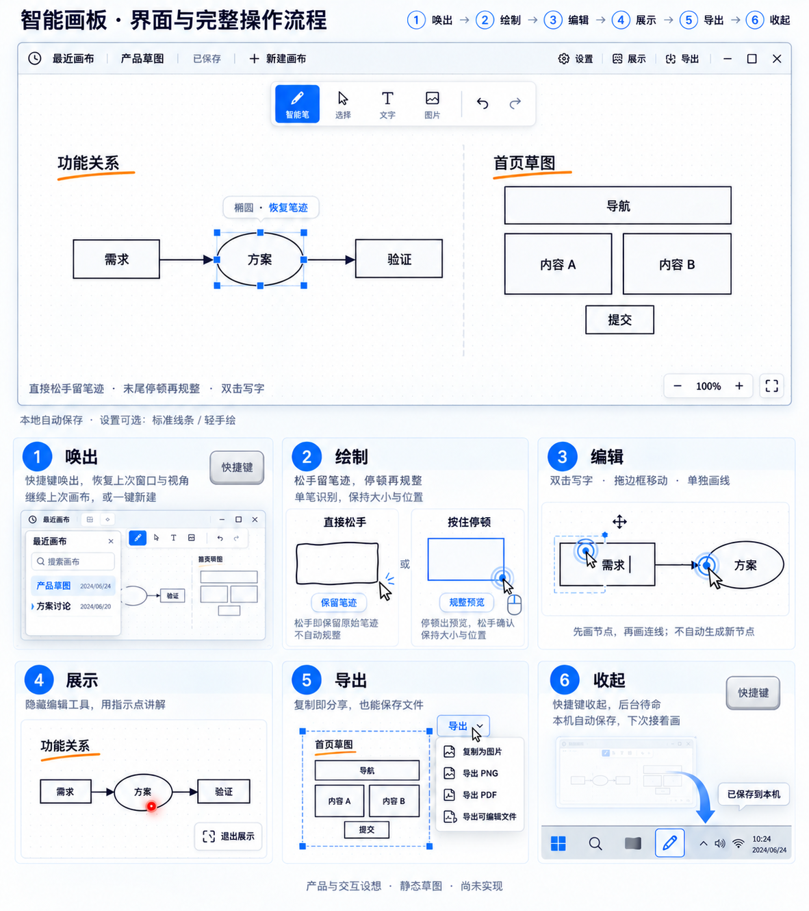

# DrawingBoard 产品形态、功能范围与交互设计

| 项目 | 内容 |
| --- | --- |
| 文档版本 | v1.0 |
| 整理日期 | 2026-10-19 |
| 项目代号 | DrawingBoard；正式产品名称未确定 |
| 平台 | Windows 桌面应用 |
| 当前阶段 | 产品设计；尚未编写应用代码，尚未进行可交互原型或运行验证 |
| 设计依据 | 本次产品讨论中的明确选择、修正意见，以及最后认可的整合草图 |
| 文档用途 | 固化产品方向与交互基线，为后续原型验证、范围评审和开发提供共同依据 |

本文使用三类状态：**已确认**是用户明确选择的规则或已认可整合方案中的内容；**设计补充**是为使规则衔接完整而提出的行为建议，不等同于新增的已确认需求；**待验证**是需要后续原型或技术验证才能确定的参数与可行性。任何状态均不代表功能已经实现。

## 1. 产品定位

这是一个能够随时唤出的 Windows 思考画板。用户以鼠标和键盘操作，在同一块自由画布上混合使用原始笔迹、可编辑图形、文字、连线和图片，快速把想法变成可以讨论、修改和分享的内容。

典型用途包括：

- 梳理结构、功能关系、流程和思维链。
- 随手记下草图与临时想法，之后继续整理。
- 在讨论中组合产品页面的功能分区和低保真布局。
- 展示方案、指出关系，再导出或复制给其他人。

会议讨论是其中一个场景。产品不依赖会议软件，也不要求先建立项目、命名文档或选用模板才能开始画。

核心体验目标：**打开就能接着画；同一支智能笔既能保留随手画，也能按用户意图规整；完成后能继续编辑、展示、导出并收起。** 启动和识别速度目前是体验目标，没有测量结果或已承诺的数值。

## 2. 已确认的决策基线

| 编号 | 决策 | 对产品的约束 |
| --- | --- | --- |
| D01 | Windows，鼠标和键盘为主，手绘为辅 | 不以触控笔或触屏作为完成核心任务的前提 |
| D02 | 后台待命，全局快捷键唤出和收起 | 用户可以在其他工作之间快速切换到画板 |
| D03 | 普通可调整大小的窗口 | 记住窗口大小、位置；可手动最大化 |
| D04 | 默认继续上次画布，同时提供一键新建 | 恢复上次内容和视角，不先进入强制新建流程 |
| D05 | 无限画布，通过命名区域组织内容 | 页面、方案可以在同一画布中并排比较 |
| D06 | 以智能画笔为主要绘制方式 | 不要求先用 R、E 等按键指定矩形或椭圆 |
| D07 | 直接松手保留笔迹 | 普通松手不能自动把笔迹替换为图形 |
| D08 | 笔画末尾按住鼠标停顿，出现规整预览，随后松手确认 | 持续移动时不能仅因按住时间长而触发规整 |
| D09 | 只识别单笔 | 分别画出的多笔不自动合并为一个图形 |
| D10 | 规整保留大致位置、大小和比例，结果可编辑 | 不能任意重排内容；提供恢复笔迹的方式 |
| D11 | 规整完成后仍可继续使用智能笔 | 不要求每画一个对象都重新切换工具 |
| D12 | 图形内部空白处可继续画；拖动边框移动图形 | 普通大矩形不会占据整个内部绘图空间 |
| D13 | 双击输入文字，区分图形标签和独立文字 | 双击边框编辑图形标签；双击空白处创建独立文字 |
| D14 | 先画节点，再单独画连线 | 连向空白处不能自动生成新节点 |
| D15 | 连线两端都连接图形时，默认沿绘制方向带箭头 | 可去掉箭头；移动图形时连接关系跟随 |
| D16 | 支持静态页面布局草图 | 组合框、文字、图片等讨论布局；首版不承担点击跳转原型 |
| D17 | 本地自动保存，离线使用，无需登录 | 日常使用不依赖云端账户或网络 |
| D18 | 用最近画布抽屉找回内容 | 以最近使用顺序和搜索为主要入口 |
| D19 | 复制为图片、导出图片/PDF、导出可编辑文件都要有 | 三类交付路径都在范围内 |
| D20 | 独立展示模式 | 隐藏编辑工具，支持讲解指示，避免误修改 |
| D21 | 在设置中选择图形风格 | 支持标准线条、轻手绘；保留原始笔迹本身的样子 |
| D22 | 首版不加入生成式 AI | 几何识别属于智能笔能力，不等同于提示词生成图或页面 |
| D23 | 画布占据主体，工具保持轻量 | 使用浮动工具条、按需属性菜单，避免常驻复杂侧栏 |

这些决策共同构成当前产品方向。具体触发阈值、完整识别种类、文件格式和技术实现尚未由这些决策确定。

## 3. 功能范围与边界

### 3.1 当前首版范围

| 能力 | 应覆盖的内容 | 边界 |
| --- | --- | --- |
| 快速进入 | 后台待命、快捷键唤出、恢复窗口与上次画布、一键新建 | 快捷键组合和开机启动策略另行确定 |
| 自由画布 | 平移、缩放、原始笔迹、可编辑图形、文字、图片 | 不预设有限纸张大小 |
| 智能笔 | 单笔绘制、直接松手留笔迹、末尾停顿规整、恢复笔迹 | 不进行跨多笔图形拼接 |
| 对象编辑 | 选择、移动、缩放、删除、复制、撤销/重做、基础样式 | 精确操作参数需原型验证 |
| 关系表达 | 图形间连线、端点吸附、方向箭头、跟随移动 | 不自动新增节点 |
| 布局整理 | 组合、对齐、等距排列；命名区域 | 不自动推断业务结构或生成页面 |
| 素材输入 | 图片粘贴、拖入或通过图片入口插入 | 图片不会自动拆解为可编辑页面组件 |
| 内容管理 | 本地自动保存、最近画布、搜索、重命名、再次打开 | 首版不以复杂目录树作为主入口 |
| 展示 | 隐藏编辑工具、指示点、退出后继续编辑 | 指示点属于临时效果，不写入内容 |
| 交付 | 复制图片、导出 PNG/PDF、导出并重新打开可编辑文件 | PDF 和图片不承诺可反向恢复编辑结构 |
| 设置 | 图形风格选择；未来验证后确定必要交互参数 | 不把尚未确定的高级配置全部放入首版 |

上述对象整理和图片能力来自已认可的完整方案。具体菜单位置、组合键和属性项仍属于界面细化，不因进入范围就意味着所有细节已经拍板。

### 3.2 当前不纳入的能力

- 生成式 AI：文字生成结构图、自动生成页面、聊天式改图等。
- 点击跳转、真实表单提交等交互原型能力，以及从草图直接生成应用代码。
- 多笔自动合并识别，以及画连线时自动创建节点。

云端实时协作、账户体系、团队权限、插件市场、跨设备同步和专业绘画功能未列入本次首版范围。这是范围控制，不表示用户已经永久否定这些方向。

## 4. 界面形态

图 1：最后认可的整合草图。它是 AI 生成的静态设计示意，**不是应用运行截图**；其中示例名称、日期、时间及图形内容仅用于表达界面。遇到草图省略细节的情况，以本文明确写出的交互规则为准。

### 4.1 主窗口

- 顶栏左侧：最近画布、当前画布名称、保存状态、一键新建。
- 顶栏右侧：设置、展示、导出和窗口控制。
- 画布上方：小型浮动工具条，包含智能笔、选择、文字、图片、撤销和重做。
- 画布主体：绘图和内容编辑空间，容纳多个结构图和页面区域。
- 对象附近：选择后显示控制点和必要属性；识别后可显示识别类型及“恢复笔迹”。
- 左下角：简短操作提示，例如“直接松手留笔迹 · 末尾停顿再规整 · 双击写字”。
- 右下角：缩放、适配视图等视角操作。

画布使用浅色和轻量背景标记是当前草图的视觉方向。具体字号、颜色、图标和密度还没有形成最终视觉规范。

### 4.2 辅助界面

| 界面 | 出现时机 | 主要内容 |
| --- | --- | --- |
| 最近画布抽屉 | 用户主动打开 | 最近使用列表、搜索、重命名和继续编辑 |
| 对象属性菜单 | 选择对象或完成识别后 | 与该对象相关的样式、箭头、恢复笔迹等 |
| 设置面板 | 用户主动打开 | 图形风格；其他设置按验证结论补充 |
| 导出面板 | 用户选择导出 | 交付类型、内容范围、预览和保存位置 |
| 展示模式 | 用户主动进入 | 内容、临时指示点、退出展示入口 |

这些界面按需出现，不长期挤占主要绘图空间。

## 5. 内容概念与组织方式

以下是产品概念，不是数据库表、文件结构或技术架构。

| 概念 | 含义 | 与其他内容的关系 |
| --- | --- | --- |
| 画布 | 可以持续编辑的一份工作内容，具有自己的视角和名称 | 包含对象与命名区域；最近列表以画布为单位 |
| 原始笔迹 | 用户实际画出的单笔路径 | 默认保留；可以成为规整图形的恢复来源 |
| 可编辑图形 | 经规整形成的几何对象 | 可移动、缩放、设置样式、附带标签、连接其他图形 |
| 图形标签 | 与一个图形绑定的文字 | 随图形移动，区别于独立文本 |
| 独立文字 | 放置在任意位置的文本对象 | 可以位于图形内部，但不会因此自动成为其标签 |
| 连线 | 表达对象关系的线，具有端点和箭头属性 | 端点连接到图形后，随关联图形移动 |
| 图片 | 插入的参考图或素材 | 可移动和缩放；本身不是自动识别出的页面组件 |
| 组合 | 用户明确组合的一组对象 | 用于一起选择和移动，不等同于页面区域 |
| 命名区域 | 用户明确建立的页面或方案范围 | 用于组织、定位、展示和导出一部分内容 |

**普通大矩形、组合、命名区域必须区分。** 在大矩形内部画按钮和文本，不应自动把大矩形变成容器，也不应自动推断其内部对象属于一个组合。

设计补充：命名区域建议在移动时带动明确归属的内容，调整区域边界时不自动缩放内部文字或布局。区域的建立入口、内容归属和嵌套规则仍需原型验证，不能仅凭视觉包围关系推断归属。

## 6. 从唤出到收起的完整流程

| 步骤 | 用户动作 | 画板反馈 | 用户得到的结果 |
| --- | --- | --- | --- |
| 1. 唤出 | 使用全局快捷键 | 显示上次窗口、画布及视角 | 继续原来的工作；也可一键新建 |
| 2. 绘制 | 按住左键随手画 | 持续显示真实笔迹 | 直接松手留笔迹；末尾按住停顿则显示规整预览 |
| 3. 编辑 | 双击写字、拖边框移动、单独画连线 | 标签、控制点和连接关系可编辑 | 形成结构图、思维链或页面布局 |
| 4. 展示 | 点击展示 | 隐藏编辑工具，显示讲解指示能力 | 讲解内容，避免误画；退出后继续编辑 |
| 5. 导出 | 选择交付方式和范围 | 展示导出范围与结果反馈 | 得到剪贴板图片、PNG/PDF 或可编辑文件 |
| 6. 收起 | 再次使用全局快捷键 | 窗口隐藏，后台待命 | 本地保存，下一次继续 |

这是完整使用路径，不要求用户每次都依次完成。用户可以只画两笔便收起，也可以在编辑和展示之间往返。

设计补充：首次使用、没有可恢复画布时直接进入空白画布；新建画布先使用临时名称，不强迫命名。新建和收起都不能静默丢弃尚未保存的内容。

## 7. 智能画笔：绘制与规整

### 7.1 主规则

1. 在可绘制的空白处按下鼠标左键，开始记录一条笔迹。
2. 拖动鼠标时，实时显示笔迹；不要求预选形状。
3. **在规整预览出现之前松手：保留原始笔迹，不自动规整。**
4. 如果希望规整，在笔画末尾保持左键按下，同时让指针停住。
5. 达到有效停顿条件且存在可信候选时，显示规整预览。
6. 预览出现后松手，确认可编辑图形；保留恢复原始笔迹的途径。
7. 完成后仍处于智能笔工具，可以继续下一笔。

识别应参考这一笔的形状、覆盖范围和比例。一个横向的粗略椭圆不能无故变成尺寸不同的正圆；一个矩形不能被移动到其他位置。

### 7.2 状态与反馈

| 当前状态 | 事件 | 结果 | 依据 |
| --- | --- | --- | --- |
| 空闲 | 空白处按下并移动 | 开始一条新笔迹 | 已确认 |
| 绘制中 | 持续移动 | 继续绘制，不能仅按累计按住时长触发 | 已确认 |
| 绘制中 | 直接松手 | 固定为原始笔迹 | 已确认 |
| 绘制中 | 末尾按住且停顿 | 满足识别条件时显示规整预览 | 已确认 |
| 等待/识别中 | 没有可靠候选 | 保持原始笔迹，不强行替换 | 已确认方向，阈值待验证 |
| 规整预览中 | 松手 | 确认可编辑图形 | 已确认 |
| 规整预览中 | 再次明显移动 | 建议回到本笔绘制，之后可再次停顿 | 设计补充，待验证 |
| 规整完成 | 选择恢复笔迹 | 返回此次规整前的原始形态 | 已确认 |

停顿必须同时考虑时间和移动幅度。具体时长、抖动容忍范围、候选稳定性和识别置信条件尚未确定，不能在开发时随意把普通鼠标运动中的减速当成确认动作。

### 7.3 单笔与识别范围

- 一笔画出的闭合轮廓可以尝试规整。
- 分别画出的四条边仍是四笔，不自动合并成矩形。
- 未识别的内容仍可作为笔迹保存、选择、移动和导出。
- 识别失败不应导致笔迹丢失，也不应强制用户重画。

目前明确讨论的基础对象包括矩形、圆/椭圆和用于关系表达的线。三角形、菱形、折线及其他形状属于识别集合候选，首版完整清单与可接受质量需要后续验证。不能把草图上出现的几何形状视为算法已经支持的证据。

### 7.4 撤销与恢复

“恢复笔迹”针对某次规整；“撤销”针对编辑操作历史，两者需要清晰区分。

设计补充：一次已完成绘制应成为可理解的撤销单元，避免用户撤销时经历不可见的内部识别步骤。规整后又移动或缩放的对象，恢复笔迹如何保留这些变化，需要验证后明确；不能承诺恢复会保留或删除尚未定义的标签、连接关系。

## 8. 鼠标、键盘与文字编辑

### 8.1 智能笔状态下的基本分工

| 命中位置或动作 | 预期行为 |
| --- | --- |
| 空白画布按下拖动 | 绘制 |
| 大图形内部空白处按下拖动 | 继续绘制，可以画内部布局 |
| 图形边框按下拖动 | 移动该图形 |
| 已选对象的缩放控制点拖动 | 调整对象大小 |
| 双击图形边框 | 输入或编辑图形内部绑定标签 |
| 双击空白画布、图形内部空白处 | 在该位置创建独立文字 |
| 双击已有文字 | 编辑该文字 |
| 使用选择工具 | 明确进入对象选择、框选和批量整理 |

这里“内部空白”不包括已经存在的文字、图片、其他对象边框或操作控制点。大图形内部仍能绘制是核心约束，不能用整块内部拖动移动来覆盖它。

设计补充：应在指针接近边框或控制点时给出清晰反馈。控件、文字编辑、控制点、边框和空白绘制之间需要稳定的命中优先级，具体容差要用鼠标实测，尤其要覆盖重叠对象和高缩放比例。

### 8.2 文字输入

- 图形标签用于给节点命名；移动图形时标签跟随。
- 独立文字用于标题、说明、注释和页面文案；放在图形内部也保持独立，除非用户明确组合。
- 正在输入文字时，中文输入法和文本编辑优先，不触发画图用的单字母操作。
- 当前流程采用 Enter 换行，点击外部或 Esc 退出文字编辑并保留已提交的内容。
- 在中文输入法候选或组合输入尚未结束时，Esc 应优先交给输入法处理，不能意外收起画板或删除文字。

文字工具入口保留，供用户主动选择；双击是快速入口，不要求每次输入都切换工具。

### 8.3 键盘操作的地位

键盘服务于唤出、文字和常用编辑，不以“背诵形状快捷键”作为绘图的必要条件。撤销、重做、复制、粘贴、删除等常见编辑操作应可达。

设计补充：平移可验证“按住空格并拖动”，复制和编辑可优先采用 Windows 习惯。具体快捷键表尚未锁定，尤其是全局唤出键、展示退出与 Esc 的上下文优先级；不能将示例组合键写成已确认要求。

## 9. 连线与关系表达

### 9.1 绘制顺序

1. 先分别画出需要连接的节点。
2. 在第一个图形附近的空白处起笔，向第二个已有图形绘制连线。
3. 在末尾按住停顿，显示线条规整和可能的端点连接预览。
4. 松手确认；若两端均连接到图形，默认沿绘制方向添加箭头。
5. 用户可以修改箭头属性；移动已连接图形时，端点跟随。

从边框直接拖动已经定义为移动图形，因此常规连线应从附近空白起笔，不能让同一个动作在没有提示的情况下同时代表移动和连线。

### 9.2 连接规则

- 连接和规整都要有可见反馈，不能仅凭看起来接触就让用户猜是否已经绑定。
- 直接松手的原始笔迹不自动变成关联连线，也不自动加箭头。
- 两端均绑定已有图形后，默认方向从起笔一端指向结束一端；可去掉箭头。
- 连到空白处不自动创建新节点。
- 移动图形时，已建立的连接关系保持；移动后不应留下视觉上脱开的旧端点。
- 单端连接、重接端点、连线绕行、折点编辑及重叠节点的吸附优先级尚需细化，不在本文虚构为已确认行为。

此方案的主要验证风险是：靠近边框起笔时，系统能否稳定区分“移动节点”和“开始画线”。如果实测冲突明显，应调整提示或增加明确入口，不能悄悄牺牲已确认的边框移动规则。

## 10. 组合页面布局

页面布局仍使用同一画布和同一套基本对象，无需切换到另一种复杂编辑器。

示例操作：画一个较大的外框表达页面范围，在里面画导航、内容区、卡片或按钮，再双击补上文字；放入参考图片；用复制、对齐、等距排列和组合整理布局；需要作为独立页面管理时，明确建立并命名一个区域。

规则：

- 内部控件不因画在大框内就失去可编辑性。
- 图形加文字即可表达按钮、输入框、列表和卡片，不要求首版建立庞大的组件库。
- 组合是用户明确操作；取消组合后仍是原来的可编辑对象。
- 对齐和等距排列辅助整理，不能自动改写用户的布局意图。
- 命名区域可表达“首页草图”“方案 A”等，支持在同一画布并排讨论。
- 页面没有真实跳转、点击响应或业务运行能力；按钮示意只是静态设计内容。

常用静态元素是否需要预设入口，以及预设的数量与形式，可在原型阶段评估。不能把低保真布局范围扩大成完整 UI 组件设计平台。

## 11. 本地保存、恢复与画布管理

### 11.1 正常使用

- 编辑内容自动保存到本地；使用画板不要求登录或联网。
- 顶栏显示清楚的保存状态。
- 唤出后继续上次画布，恢复视角和窗口状态。
- 最近画布按最近使用排序，支持搜索、重命名和继续打开。
- 一键新建独立空白画布，不覆盖旧画布。
- 收起进入后台待命，内容可在下次唤出后继续。
- 导出的可编辑文件能够再次打开并继续编辑，用于备份或转移。

### 11.2 需要遵守的保护原则

以下为设计补充，尚无实现验证：

- 只有本地写入成功才能显示“已保存”；写入失败应明确提示，并保留当前编辑内容。
- 新建、切换画布、收起或退出都应处理尚未完成的保存，避免静默丢失。
- 如果上次画布无法读取，应说明具体情况并提供继续操作入口，不能伪装为正常空白画布覆盖原内容。
- 多显示器或分辨率变化后，恢复窗口要确保仍可见，不能将窗口留在已断开的屏幕范围内。
- 应将一般收起与完全退出区分；关闭按钮是否等同于收起、托盘菜单与开机启动策略仍需明确。

本地保存目录、文件格式、版本兼容、崩溃恢复和可编辑文件打开时是否创建副本，目前尚未确定。本文只确定用户应得到的结果，不指定存储技术。

## 12. 展示模式

进入展示后，画布用于阅读和讲解：隐藏编辑工具、选择框和控制点，避免普通鼠标动作修改内容；提供临时指示点或类似激光笔的效果；保留清晰的退出入口。

退出后回到编辑，内容仍可修改。展示期间的指示效果不进入撤销历史、不保存为图形，也不出现在导出文件中。

设计补充：展示可平移、缩放或适配内容；进入时如何选择当前视角、选区或命名区域，是否自动全屏，以及退出时恢复哪一视角，需要原型确认。专用展示模式已确认，但不能据此推断强制全屏已经确认。

## 13. 导出与分享

| 交付方式 | 用途 | 应保留什么 |
| --- | --- | --- |
| 复制为图片 | 快速粘贴到聊天、文档或其他应用 | 所选内容的可视结果 |
| 导出 PNG | 保存或发送静态图片 | 当前对象外观、文字、图片和连接线 |
| 导出 PDF | 阅读、打印、评审 | 可读的静态版式；分页方式另行细化 |
| 导出可编辑文件 | 备份、转移、继续编辑 | 对象、文字、连接关系和组织信息的可编辑语义 |

三类路径都必须覆盖：剪贴板图片、静态文件、可编辑文件。图片和 PDF 无需承担恢复编辑结构的责任。

设计补充：导出应明确范围，建议支持选中内容、命名区域和整幅画布中的有效内容，并提供边界预览。无限画布的“全部”指内容范围，而不是无限大小的背景。无选区时的默认范围、PNG 尺寸/背景、PDF 分页、可编辑文件能否局部导出仍待确定。

导出不能包含选择控制点、操作提示或临时指示点；成功与失败都应准确反馈，不将打开对话框等同于已经保存文件。导出结果不得修改原画布。

## 14. 风格与设置

已确认由用户在设置中选择图形风格：

- **标准线条**：规整、清晰，便于讨论结构和页面布局。
- **轻手绘**：保留轻微手绘观感，但仍然是可编辑图形。

风格是图形的外观选择，不改变“直接松手保留笔迹、按住停顿才规整”的规则。原始笔迹不因风格切换被重新绘制。

当前草图采用标准线条。将标准线条作为默认值只是设计建议，用户尚未单独确认默认风格。风格切换作用于新建对象、当前画布还是已有对象，以及是否支持对象级覆盖，都需明确后再实现。

停顿触发参数是否允许用户调整，应先验证默认体验，再决定是否放入设置；不应把识别不稳定简单转嫁成大量配置项。

## 15. 后续验证与验收清单

下表是未来可交互原型和应用的验证要求，**全部尚未执行**。本次交付只能验证文档、图片与规则的一致性，不能证明交互已可用。

| 编号 | 验证场景 | 预期结果 | 对应决策 |
| --- | --- | --- | --- |
| V01 | 从其他应用唤出，再收起，再次唤出 | 恢复上次画布、窗口和视角，可直接继续 | D02–D04 |
| V02 | 当前已有内容时一键新建 | 获得空白画布，旧内容仍可从最近列表找回 | D04、D17–D18 |
| V03 | 画粗略矩形后直接松手 | 保留原始笔迹，不发生自动规整 | D07 |
| V04 | 一笔画轮廓，末尾按住停顿后松手 | 先看到规整预览，再得到位置尺寸相近的可编辑对象 | D08–D10 |
| V05 | 持续缓慢绘制；分别画四条边 | 不因累计按住时长误触发；不把四笔合并 | D08–D09 |
| V06 | 绘制无法可靠识别的形状；执行恢复笔迹 | 无笔迹丢失；恢复路径可理解 | D10 |
| V07 | 在大图形内部绘制、拖边框、拖控制点 | 分别对应绘制、移动和缩放，没有意外切换 | D12 |
| V08 | 双击边框、双击内部空白、编辑已有文本 | 分别创建/编辑标签、独立文字和原文本 | D13 |
| V09 | 使用中文输入法、Enter 和 Esc | 不误触发绘图快捷键，不丢失已提交文字 | D01、D13 |
| V10 | 连接两个已有节点，再移动节点 | 两端绑定后按绘制方向带箭头，关系跟随 | D14–D15 |
| V11 | 从节点附近画向空白并确认 | 不自动新增节点；普通笔迹不自动加箭头 | D07、D14 |
| V12 | 组合导航、卡片、按钮和文字形成页面 | 内部内容可继续编辑，组合和区域语义明确 | D05、D16 |
| V13 | 编辑、展示、指示、退出展示 | 展示不误改内容，指示效果不持久化 | D20 |
| V14 | 分别复制图片、导出 PNG/PDF、导出并重新打开可编辑文件 | 静态结果正确；可编辑内容及连接语义保留 | D19 |
| V15 | 离线使用、正常退出重开、保存失败 | 不依赖登录联网；保存状态真实，失败不静默丢内容 | D17 |
| V16 | 切换图形风格 | 规整对象仍可编辑，原始笔迹不被改写 | D21 |
| V17 | 切换显示器、高 DPI、不同缩放与输入设备 | 窗口可见，文字可读，边框与控制点可稳定操作 | D01、D03、D12 |

体验验证应观察用户能否理解两种松手结果、是否误触移动、能否轻松连线、是否需要反复切换工具，以及能否在中断后快速继续。响应时间、识别率和可承载内容规模应经真实测试后设定目标，不在本次文档中伪造测量值。

## 16. 尚需确定的参数与细节

这些事项不推翻当前产品方向；后续应围绕真实操作逐项确认，而不是重新泛化产品定位。

| 事项 | 当前边界 | 下一步如何确定 |
| --- | --- | --- |
| 全局快捷键和退出规则 | 快捷键唤出/收起已定；具体组合、关闭按钮和完全退出未定 | 验证系统冲突与窗口习惯，明确不同退出入口 |
| 停顿与移动阈值 | 必须是末尾按住且停住 | 用鼠标实测误触和等待感，选取默认值 |
| 识别种类和容错 | 单笔、保留原迹、失败不强改 | 用真实粗画样例确认首版清单和质量边界 |
| 规整预览取消及恢复笔迹 | 预览后松手确认；可恢复原迹 | 验证继续拖动、撤销和后续编辑后的恢复语义 |
| 命中与吸附 | 内部画、边框移动、两端绑定默认箭头 | 测试边框附近起笔、重叠图形和不同缩放 |
| 文字与快捷键 | 中文输入优先，双击规则已定 | 验证输入法、换行、退出编辑和焦点切换 |
| 区域组织 | 无限画布加命名区域 | 明确创建、归属、移动、边界调整和嵌套规则 |
| 展示视角 | 独立展示模式已定 | 确认进入范围、导航、全屏与退出视角 |
| 导出细节 | 三类交付路径必须都有 | 确认范围默认值、图像尺寸、PDF 分页和文件重开流程 |
| 风格作用范围 | 标准线条和轻手绘可选 | 确认默认风格及切换对已有对象的影响 |
| 持久化与兼容 | 本地自动保存、离线、可编辑文件 | 设计保存失败、恢复、版本兼容及备份行为 |
| 性能和系统支持 | Windows 快开体验，尚无量化承诺 | 确认支持的系统版本，测启动、绘制和大画布表现 |

技术栈、识别算法、渲染引擎、打包方式和文件格式不在本次产品设计中锁定。后续技术选择应服务于上述交互，而不是反过来削弱已经确认的规则。

## 17. 已被替代的方案

为避免后续根据早期草图或片段重新引入旧规则，保留以下变更记录：

| 早期方向 | 当前有效规则 |
| --- | --- |
| 先按 R/E 等键指定形状，再拖动生成 | 随手画，末尾按住停顿触发识别；无需预先指定形状 |
| 普通松手就自动识别 | 直接松手留原迹；出现停顿规整预览后松手才确认图形 |
| 多笔可自动拼成一个图形 | 只识别单笔，不跨笔自动合并 |
| 连线拖到空白自动增加节点 | 节点和连线分别绘制，不自动生成新节点 |
| 风格由界面固定一种 | 设置可选标准线条或轻手绘；默认和作用范围另行确定 |

## 18. 交付与后续使用说明

本次交付包括本设计文档、项目入口 README 和已认可的整合草图。没有应用代码、安装包、可交互原型、运行截图或功能测试结果。

草图仅用于表达产品形态。Procreate 的“画后按住”是此前讨论的交互启发，不代表本项目已获取、复用或验证其内部算法，也不构成本项目实现的依赖。

后续新增决策应更新本文件中对应规则与验证要求，并记录版本变化；在完成可交互验证前，不应把“已确认需求”改写成“已实现能力”。本次未形成开发排期，也未启动代码实现。

| 版本 | 日期 | 内容 |
| --- | --- | --- |
| v1.0 | 2026-10-19 | 汇总产品定位、已确认决策、首版范围、界面与操作规则，附整合草图，分离设计补充和待验证事项 |
