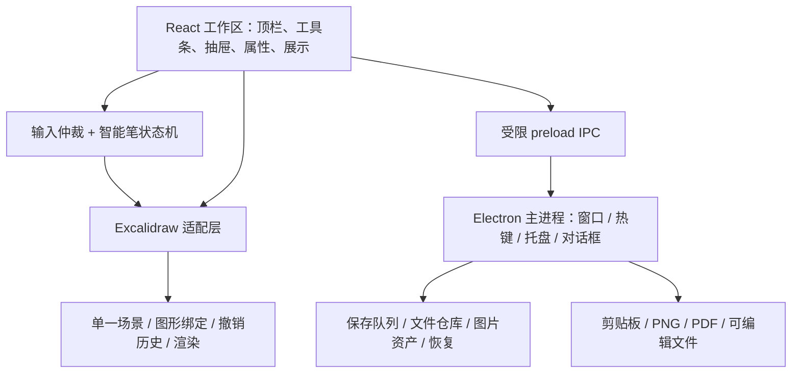

# DrawingBoard 技术设计与开发边界

初版日期：2026-10-19；修订日期：2026-10-20。状态：**沿用现有技术路线，补充 GazBoard 借鉴边界；P0 已有实现，完成度以验证记录为准**。产品依据：[产品设计 v1.0](2026-10-19-drawingboard-product-design.md)；技术依据：[调研报告](../../research/2026-10-19/research-report.md)；执行清单：[开发计划](../plans/2026-10-19-drawingboard-development-plan.md)。本文不改写产品文档的 D01–D23。

## 1. 目标与当前事实

交付一款 Windows 普通窗口应用：后台唤出、恢复上次画布，鼠标智能笔绘制，可编辑文字/图形/连接，组合静态页面，离线自动保存，展示、复制图片、PNG/PDF 和可编辑文件导出。

2026-10-20 文档修订时，当前目录已有 Git、源码与锁文件，HEAD 为 `9e1ef56`，T03 相关修改仍在工作区。实现与测试记录从 [P0 证据](../../validation/p0-evidence.md)进入；本次没有重跑测试，不把代码存在或历史测试记录写成完整 P0 通过。用户已确认继续现有方案，并将 GazBoard 的可借鉴模块与机制纳入实施参考；本轮只修订文档，不改应用代码或重新安排实施分支。

工程原则：一个画布核心、一套对象关系、一套撤销历史；自研产品交互，复用成熟编辑能力。先验证输入控制权和桌面性能，再做完整功能；验证失败时不得偷偷修改产品规则以迁就底座。

## 2. 推荐技术路线与决策门槛

| 层次 | 首选方案 | 理由与边界 |
| --- | --- | --- |
| 桌面外壳 | Electron，普通有边框窗口 | 文件、托盘、全局快捷键、剪贴板、PDF 输出集中；不是已经证明最快或最省内存 |
| 界面 | React + TypeScript + Vite；普通 CSS tokens | 与 Excalidraw 接入方向一致；不引入大型后台 UI 框架 |
| 画布核心 | 固定版本的 Excalidraw | 优先复用对象、绑定、历史、图像和几何呈现；适配能力经 P0 决定 |
| 交互层 | 自研纯 TypeScript 状态机 + 窄编辑器适配层 | 采样、停顿、命中优先级、双击分工归产品控制 |
| 识别 | 优先验证 Excalidraw 单笔分类与转换 | 首批矩形、圆/椭圆、直线；其他种类先关闭，不强推断 |
| 本地数据 | 每画布目录、版本化 JSON、按内容哈希保存图片 | 首版无需数据库；文件内容为事实来源，最近列表是可重建索引 |
| 静态导出 | 核心生成 PNG；Electron 生成 PDF | 首版 PDF 可用高清栅格，不承诺矢量或反向编辑 |
| 可编辑文件 | `.drawingboard` ZIP 包 | 清单、场景、图片、原迹来源一起带走，支持离线往返 |
| 测试 | Vitest；Playwright 浏览器/Electron 测试；真实 Windows 人工操作 | 自动化不能替代中文输入法、系统热键、混合 DPI 和安装验证 |
| 打包 | electron-builder；Windows x64 用户级安装包 | 实施时核对稳定版本及签名配置；不需要管理员权限执行日常绘图 |

**版本锁定规则。** P0 开始时读取官方稳定发布信息及依赖 peerDependencies，固定 Electron、React、Vite、测试/打包工具的精确版本，提交锁文件和 `docs/engineering/dependency-baseline.md`；后续安装使用冻结锁文件，不使用浮动 latest。Excalidraw 第一验证对象固定为本轮读过的提交 `e1b7aacb356a492aa1e0fc6eb57b8896124027f0`，其依赖以该提交声明为准。不得把该主分支能力归到 npm 稳定包；如果改用发行包，重新跑全部适配门槛。

**Excalidraw 接入的决策顺序。**

1. 先试公开 custom tool 与宿主指针处理，证明完整行为、原迹回退、绑定和历史可控。
2. 若公开接口无法接管，允许在 P0 对固定源码做最小适配补丁实验；补丁只服务输入、双击分工、提交/恢复、绑定和序列化。记录每处改动、对应上游文件和回归用例，不复制整个 showcase 应用。
3. 若必须复制大型 App 实现、形成两套场景/历史，或升级后难以定位行为，P0 判为不通过，提交具体失败证据。此时比较获得合适授权的 tldraw 或重新评估核心，不在失败底座上继续完整开发。
4. 如采用源码补丁，导入固定上游快照到 `vendor/excalidraw/`，保留许可、原始 SHA、补丁清单和构建方法；这是未来执行动作，本轮不下载该快照。

**外壳选择的理由和替代条件。** Electron 提供 [printToPDF](https://www.electronjs.org/docs/latest/api/web-contents#contentsprinttopdfoptions) 和 [globalShortcut](https://www.electronjs.org/docs/latest/api/global-shortcut)。Tauri 是备选，但其 Windows WebView2 的在线/离线分发有不同方案，不能仅比较不含运行时的安装包大小：[Tauri Windows installer](https://v2.tauri.app/distribute/windows-installer/)。若 P0 中后台占用或唤出表现不可接受，再用相同场景实测 Tauri，而不是同时维护两套宿主。

许可采用调研的固定提交结论；所有真正引入的字体、图标、压缩库、上游依赖在 P0/P3 核查。tldraw 不作为无条件免费依赖；不直接移植 GPL/AGPL 实现到本方案中，除非另行明确整体分发许可。

## 2.1 GazBoard 借鉴决策与复用边界（2026-10-20）

继续使用 **Electron + Excalidraw 单一场景/绑定/历史 + 自有产品交互层**。本节是用户确认后的技术路线补充，不修改产品 D01–D23，也不将 A01–A09 自动升级为已确认决策。

来源冻结为 GazBoard `v4.9.4` / `13beea0ccd86190e65d5124697dc948f6cbb87c6`，证据来自 2026-10-19 的[逐项评估](../../research/2026-10-19/gazboard-fit-gap-and-adaptation-assessment.md)与[识别探针](../../research/2026-10-19/gazboard-recognizer-probe.json)。这是固定版本参考，不声称 2026-10-20 已复核上游最新版本；采用其他提交时重查差异与许可。

**三种使用方式：**

- **局部源码移植候选**：仅限依赖清楚的小型纯函数；先检查本项目是否已有等价能力，映射现有类型，保留许可和来源，验证后才引入。“候选”不表示已复制或必须复制。
- **机制/测试复用**：借用行为、异常路径和测试样例，在现有模块中实现；不导入 GazBoard 对象、运行时或场景仓库。
- **产品自有适配**：由我们的输入、保存、展示等模块决定规则，继续使用 Excalidraw 编辑能力。不能为了复用而改变已确认的鼠标操作。

| ID | 借鉴点与固定来源 | 可复用部分 | 必须适配的部分、排除项 | 责任任务 |
| --- | --- | --- | --- | --- |
| GZ01 | [recent.js][gz-recent]、[库搜索][gz-search] | 最近记录去重、按打开时间排序、重命名同步及缺失项提示；小型纯函数可局部移植 | 接到现有 BoardSummary/Repository/session；catalog 与 lastOpenedAt 保持唯一来源，最近列表是派生视图。缺失引用只显示不可用提示，不创建空画布或静默删除。条数 12/8、settings 结构和整个库 UI 不照搬 | T07、T08、T12 |
| GZ02 | [connectors.js][gz-connectors] | 端点几何、目标删除回退和组合移动等测试案例；默认只参考机制 | 使用现有 connection-policy/Adapter 与 Excalidraw 绑定，不导入 GazBoard connector 模型、路由渲染或第二套历史。仍是先节点后线、两端绑定才默认箭头；首版不增加曲线/自动绕障 | T03、T05 |
| GZ03 | [board-export.js][gz-board-export]、[export.js][gz-export] | 导出取当前内存一致快照、解析完整图片、缺图阻止成功、剔除机器私有路径；静态栅格到 PDF 的链路 | 接到既有 ExportRequest/RasterResult 和 .drawingboard 包，三类静态输出共用本项目栅格结果；扩展 provenance/区域等本项目语义。原路径保存失败时仍可导出到另选位置；不复制 GazBoard 文件身份、印记或任意文件读写桥 | T10、T11 |
| GZ04 | [保存与资产链][gz-save] | 按画布串行保存、图片资产分离、缺失资产保留引用、恢复时拒绝迟到结果；复用设计和故障用例 | 继续采用 clientSeq/opId/revision、资产先写、旧文件保留。禁止复制“保存失败继续切换”“rename 失败直接覆盖原文件”“flush 失败仍确认退出”和仅按 boardId 清脏状态 | T07、T08 |
| GZ05 | [窗口恢复][gz-window]、[恢复画布][gz-resume] | 窗口可见性检查与防异步恢复覆盖的机制；若现模块缺失，小型几何辅助可评估局部移植 | 接到现有 Electron 生命周期、全局热键和保存确认；恢复完整视角，不继承启动强制缩放到 1。高 DPI/拔屏/焦点必须真机验收；不以设置文件存在算恢复成功 | T03、T08、T13 |
| GZ06 | [展示与临时指示][gz-present] | UI 隐藏与瞬时指示层思路；只借机制 | 本项目展示时必须禁止内容编辑，允许平移/缩放/指示。指示不进 scene/history/保存/导出；按 A08 验证退出视角/工具，不复用教学模式继续画图策略 | T12、T13 |
| GZ07 | [浮动工具与弹出菜单][gz-toolbar] | 大画布、就近属性、按需入口的 GUI 组织方式 | 沿用已认可上方智能笔工具条、最近抽屉和中文反馈；不复制品牌素材，不引入计时、答案遮盖、文档转换、局域网分享等额外功能 | T08、T12 |
| GZ08 | [识别入口][gz-ink]、[分类函数][gz-recognize]、[文字编辑][gz-text] | 七组定向探针的输入构造、错误分类/拒绝门槛反例、IME 的 Esc/Ctrl+Enter 边界，作为回归来源 | 不直接移植识别器、释放自动规整或双事务替换；保留自己的停顿预览与提交。合成轨迹不等于真实鼠标识别率，DOM key 事件不等于真机 IME | T02、T03、T04、T05 |

**不重复造已有能力。** 图形创建/渲染、文字绑定、组合/对齐/分布、箭头关系、标准/轻手绘基础、撤销和序列化仍优先复用 Excalidraw；命名区域、样式作用范围等只补本项目差额。GazBoard 的命名组合/纵向纸张不能替代独立区域，铅笔笔刷不能替代可编辑图形风格。完整 `app.js`、`tools.js`、`store.js`、`surface.js` 以及教学/同步/更新系统均不纳入移植。

**采用证据。** 各责任任务在既有阶段 evidence 中记录 GZ 编号、实际动作（机制参考/源码移植/现有能力已覆盖）、目标文件和验证结果；已有用例覆盖时引用用例，不重复实现。实际复制源码的同一次变更必须在 `docs/engineering/third-party-notices.md` 记录原仓库、固定提交、原文件、目标文件、修改点与许可，并保留所需版权声明；不要等 T14 才补。根 MIT 许可不替代字体、图标和依赖核查。没有引入源码或资源时明确记“机制参考，无源码复制”，不增加 GazBoard 运行依赖。

实施动作与验收用例统一进入[开发计划](../plans/2026-10-19-drawingboard-development-plan.md)的 GZ01–GZ08 映射和原 T01–T14 任务，不另建一套 GazBoard 开发进度。当前 SDK 构造/识别接入使用固定源码内部包，仍有版本耦合；不能将“未改上游 App.tsx”写成“永远零补丁、零升级成本”。

[gz-recent]: https://github.com/fahim9778/GazBoard/blob/13beea0ccd86190e65d5124697dc948f6cbb87c6/src/js/core/recent.js
[gz-search]: https://github.com/fahim9778/GazBoard/blob/13beea0ccd86190e65d5124697dc948f6cbb87c6/src/js/ui/panels.js#L1581
[gz-connectors]: https://github.com/fahim9778/GazBoard/blob/13beea0ccd86190e65d5124697dc948f6cbb87c6/src/js/core/connectors.js
[gz-board-export]: https://github.com/fahim9778/GazBoard/blob/13beea0ccd86190e65d5124697dc948f6cbb87c6/src/js/board-export.js#L18
[gz-export]: https://github.com/fahim9778/GazBoard/blob/13beea0ccd86190e65d5124697dc948f6cbb87c6/src/js/export.js
[gz-save]: https://github.com/fahim9778/GazBoard/blob/13beea0ccd86190e65d5124697dc948f6cbb87c6/src/js/app.js#L484
[gz-window]: https://github.com/fahim9778/GazBoard/blob/13beea0ccd86190e65d5124697dc948f6cbb87c6/main.js#L698
[gz-resume]: https://github.com/fahim9778/GazBoard/blob/13beea0ccd86190e65d5124697dc948f6cbb87c6/src/js/app.js#L719
[gz-present]: https://github.com/fahim9778/GazBoard/blob/13beea0ccd86190e65d5124697dc948f6cbb87c6/src/js/app.js#L2148
[gz-toolbar]: https://github.com/fahim9778/GazBoard/blob/13beea0ccd86190e65d5124697dc948f6cbb87c6/src/js/ui/toolbar.js#L749
[gz-ink]: https://github.com/fahim9778/GazBoard/blob/13beea0ccd86190e65d5124697dc948f6cbb87c6/src/js/core/tools.js#L1817
[gz-recognize]: https://github.com/fahim9778/GazBoard/blob/13beea0ccd86190e65d5124697dc948f6cbb87c6/src/js/core/recognize.js#L49
[gz-text]: https://github.com/fahim9778/GazBoard/blob/13beea0ccd86190e65d5124697dc948f6cbb87c6/src/js/ui/textedit.js#L342

## 3. 模块与进程边界



- Renderer 管显示、输入和编辑语义；主进程不处理每个鼠标 move，不逐点跨进程传输。
- EditorAdapter 只封装本产品所需的命中、预览、提交、序列化和导出；不是能任意替换所有图形引擎的大型框架。
- 文档对象由画布核心持有。React 不复制一份全量元素状态；工具条只订阅必要的选择/样式摘要。
- 一次用户编辑只进入核心的一套历史。画笔预览、吸附提示、指示点和菜单开关不进文档、不进撤销。
- 主进程独占本地写入与外部文件选择，renderer 仅通过类型化业务命令访问；不暴露任意路径读写或通用 IPC 调用。
- 生产只加载打包本地资源，`nodeIntegration=false`、`contextIsolation=true`、`sandbox=true`；禁止导航到不受信任页面，导出页同样隔离。依据：[Electron Security](https://www.electronjs.org/docs/latest/tutorial/security)。

## 4. 数据模型与持久化

### 4.1 只有一份图形事实

保留 Excalidraw 原生对象 ID、文字 containerId、线端绑定、groupIds 和 frameId；不另建与其长期同步的节点/边数据库。`engine-snapshot.ts` 按固定版本的序列化结构实现验证与转换，外层格式记录 engineVersion/sourceCommit。

| 数据 | 放在哪里 | 规则 |
| --- | --- | --- |
| 规整对象、标签、独立文字、连接、组合、区域 | 引擎场景 | 对象 ID 稳定；标签与独立文本不能按空间位置自动互换 |
| 原始笔迹 | 原生笔迹对象 | 直接释放的结果；不自动添加连接或箭头 |
| 规整来源 | 对象的命名空间 `customData.drawingboard.provenance` | 来源点集、原始样式、初始局部坐标系、版本；与对象一起进入历史/复制/导出 |
| 笔画采样时间与临时预测 | 交互内存 | 用于当前停顿判定；预测点不落盘，原迹恢复不依赖预测数据 |
| 画布名称、格式版本、存储修订号 | 画布 head.json | 名称属于持久内容；格式未知时不直接打开为可写 |
| 视角、最近画布、窗口位置、设置 | session/settings | 不进入图形撤销历史；相机与窗口坐标分开 |
| 图片 | assets/ 内容哈希文件 | 写入完成后场景才引用；外部 URL 不成为离线画布必需依赖 |

Provenance 使用初始对象局部点集和坐标变换记录，避免先归一化识别再丢失真实比例。复制规整对象保留来源，修改 ID 时同步现有绑定；恢复不通过屏幕截图反推笔迹。

### 4.2 本地目录与便携文件

运行数据根目录由 Electron `app.getPath('userData')` 确定，应用身份固定为 DrawingBoard；不硬编码开发者用户名或写到项目源码目录。

```text
userData/
  settings.json                  # 窗口、热键、风格默认值、最后画布 ID
  catalog.json                   # 可重建：名称、最近打开时间、摘要
  boards/<uuid>/
    head.json                    # 唯一当前完整场景；schema/engine/revision/opId
    backup.json                  # 上一次有效场景；不是无限版本历史
    session.json                 # 相机位置与缩放
    assets/<sha256>.<ext>         # 已验证图片；保留 head/backup 引用
```

`.drawingboard` 包含 `manifest.json`、`scene.json`、`assets/`；内容包含 provenance 和所有图片，可选初始视角，不带机器窗口位置、全局快捷键、临时状态或撤销堆栈。v1 明确不承诺退出后继续撤销；同一会话切换画布后按重新载入处理。导入创建新内部画布 UUID，不覆盖同名原文件或旧画布；内部元素 ID 与绑定一起保留。

### 4.3 保存协议

1. 图形提交后递增本画布 `clientSeq`，状态为未保存。预览、选择和指示点不递增。
2. 初始工程参数为闲置 800ms 合并保存、持续编辑最长 3s 发起一次；这些是待实测的内部参数。每画布只允许一个在途保存，后续变化合并为下一份最新快照。
3. 请求包含 boardId、baseRevision、clientSeq、opId、完整场景及新增资产。主进程按画布串行校验，先将新资产落盘，再校验场景引用完整性。
4. 先保留有效旧 head 为 backup；新 head 写同目录临时文件，刷新并验证可读后替换。替换失败保留原件与当前内存；不得先删除好文件再写新文件。Windows 文件占用/中断用故障注入验证，不将 rename 直接称为断电保证。
5. 写入完成后返回 revision/clientSeq/opId。只有返回序号覆盖当前编辑序号才能显示“已保存”；旧响应不能清除新修改。重复 opId 可查询已完成结果，避免“落盘成功但回执丢失”重复提交。
6. catalog 更新是派生操作，失败不使已存场景丢失；重启可扫描 head 重建。不得让旧异步结果切回已离开的画布。

新建/切换先 flush 当前画布；失败保留当前画布并提供重试或导出恢复副本。收起请求先 flush；失败不静默隐藏，留在可见窗口提示处理。显式退出失败时保留窗口，只有用户选择放弃未保存修改才允许退出。系统强制关机/终止不能保证保住尚未落盘内容，重开检查 head/backup，坏文件保留供恢复，不用空白覆盖。

生命周期请求带唯一 requestId；结算期间暂缓新增编辑，renderer 完成当前笔/文字与保存后确认，主进程再隐藏或退出。失败取消该请求并恢复编辑，旧确认不能结束新请求。恢复副本使用完整内存快照输出到另选位置，不以原路径保存成功为前提。

导入在写入目标前验证格式、引用和资产哈希；拒绝 ZIP 路径穿越、绝对路径、重复条目、未知高版本和损坏资源。初始防护上限：归档 100MiB、解压总量 256MiB、10,000 条目、单图 40MP；为可调整的工程限制，超限明确反馈，不截断内容。首版导入图片为 PNG/JPEG/WebP，SVG/HTML 先不接受为可执行素材。

## 5. 智能笔与输入仲裁

### 5.1 状态流程

| 状态/事件 | 行为 | 文档/历史 |
| --- | --- | --- |
| idle，空白按下 | 固定 pointerId 和本笔 token；开始原始采样 | 无提交 |
| drawing，移动 | 记录真实点，显示笔迹，重置有效运动的停顿计时 | 无提交 |
| drawing，直接 up | 提交一个原始笔迹对象 | 一个撤销单元 |
| drawing，计时达到停顿条件 | 仅对当前单笔运行分类/拟合/拒绝判断 | 无提交 |
| 无可靠候选 | 保持原迹；原迹变化后才重新尝试 | 无提交 |
| preview，再次明显移动 | 原型建议：撤掉候选，继续同一笔；重新计时 | 无提交 |
| preview，up | 提交规整对象、来源和必要绑定 | 一个撤销单元 |
| Esc / 失焦 / capture lost / 收起中断 | 原型建议：取消候选，非空已采集笔迹以原迹结束；忽略该笔迟到结果 | 最多一个撤销单元 |

停顿采用真实坐标/时间与累计运动判断，不能用累计按下时长、预测坐标或只等下一次 move。计时器/异步识别结果需匹配 pointerId、token 和采样版本。识别后的微小抖动不能造成预览闪烁；具体门槛经样本验证。

初始实验参数只用于比较：停顿 500ms、抖动半径 3 DIP、有效累计移动超过 3 DIP 重置；识别最短路径与闭合质量由固定分类器加拒绝条件处理。用测试参数注入避免测试依赖墙钟。实际连续慢画、鼠标噪声与近闭合样本若出现明显误规整，则此参数组不通过，不能用放宽需求解释。

### 5.2 命中优先级

原生/应用弹窗与文本组合输入 → 界面控件 → 已选对象控制点 → 已有文字/图片等实心内容 → 可编辑图形边框 → 普通内部/画布空白。普通矩形的包围盒只做粗筛，不直接将整个内部当成可拖动面。

图形边框、控制点命中容差按屏幕 DIP 计算，再映射到画布世界坐标；优先上层可见对象。选择工具可使用面命中与框选，智能笔遵循边框/内部规则。点击尚未越过拖动阈值时不创建可见笔迹，避免双击落下两个墨点；双击位置由相同命中结果进入标签或独立文字。

连线从图形附近空白起笔，边框拖动始终是移动。只在本笔被规整为线时检测端点绑定，预览高亮候选目标；双端绑定才自动带方向箭头。初版只做直线连接，单端可绑定但不自动加箭头；同一图形两端不自动建自环。端点拖动可重接或解绑；不做自动绕障、自动节点和多折点编辑。

### 5.3 文字与恢复

复用真实 textarea 的编辑能力：Enter 换行；Esc 退出并保留已提交文字，但 `isComposing` 或组合输入期间先交给 IME。画布单字母快捷键不覆盖文本输入。粘贴优先文本编辑目标；无文本焦点时处理图片/场景对象。组合输入过程中主动收起请求延后到组合结束，不能丢失已提交文字。

恢复笔迹原型建议：把来源点应用到对象当前平移/缩放/旋转，保留用户后续位置变化。若对象有标签或连线，先给出“恢复将解除这些绑定”的具体提示：标签变为同位置独立文字，相关端点解绑但保持位置；不删除内容。全部变化可一次撤销。此行为属于新增细化建议 A04，需真实操作评审后固化，不是既有确认结论。

## 6. 区域、风格、展示与输出

- **区域**：先支持“将选区建立命名区域”；初始成员为选中的完整对象，矩形不自动升级。普通移动或视觉包围不自动增减成员，提供明确加入/移出；移动区域带成员，缩放边界不缩放成员。首版不做区域嵌套；横跨成员边界的连接按绑定目标更新，禁止双重位移。
- **风格**：原型默认标准线条，设置提供标准/轻手绘预览；切换当前画布的规整对象并作为一次撤销操作，同时作为新画布默认值。原始笔迹不改写；自定义颜色/宽度保留，字体不随风格变换，手绘种子保存。默认与作用范围为 A05 建议。
- **展示**：默认从当前视角进入，隐藏编辑 UI 和控制柄，禁用内容编辑；允许平移/缩放与临时指示点。退出恢复编辑前视角和工具；指示点不入历史/保存/导出。区域可显式选择“展示此区域”。首版不做顺序幻灯片和自动全屏切换。
- **导出范围**：选中对象、一个命名区域、全部内容。默认有选择则选区，否则全内容；界面显示边界预览，空画布禁用输出。
- **PNG/剪贴板**：同一导出模型，支持背景与倍率；初始限制单边 8192px、总像素 32MP，超限要求降低倍率或缩小范围，不静默裁切。资源和字体加载完成后导出。
- **PDF**：同源 PNG 嵌入专用本地打印页，通过 printToPDF 输出 A4 横/竖单页，保持比例；明确是静态输出。画布很大时预览缩小效果，引导选区域；多区域多页、矢量和可编辑 PDF 不作为首版必需能力。
- **导出任务**：取开始时的一致场景快照，显示范围/进度；不导出半笔或候选预览。用户取消保存对话框不算错误；失败不显示成功，文件写入完成后再反馈。外部选择路径由主进程保管。

## 7. 桌面生命周期和界面

启动注册单实例锁；第二次启动聚焦现有窗口，首版不强制文件关联。隐藏保留 renderer 和画布，暂停不必要动画；退出销毁进程并释放热键，不以关闭按钮直接等同退出。

原型建议：窗口 X 收起，托盘提供显示/新建/退出；首次收起有一次性说明。默认唤出键先试 `Ctrl+Alt+D`，设置可改；注册失败必须提示且保留托盘入口，不能抢占别的应用。没有全局 Esc；Esc 的优先级为输入法、弹窗、文本编辑、当前绘制/预览、展示、选择。开机自启首版不自动开启。

窗口位置用显示器工作区校验；旧显示器消失时移回可见区域。初始开发验收以 Windows 11 x64 为基准，Windows 10 和 ARM64 不先承诺支持；如用户需要，作为支持矩阵显式补验。

界面沿用已认可草图：顶栏左侧最近画布/名称/保存状态/新建，右侧设置/展示/导出；上方浮动工具条是智能笔/选择/文字/图片/撤销重做；对象属性就近显示。GUI 以 [已有图册](../../research/2026-10-19/product-gallery.md) 为参考，不能复制竞品品牌图标或加入未实现入口。默认中文、清晰可读字体，所有按钮有名称、焦点和键盘可达路径。

## 8. 原型建议与待收敛项

下表是为了让开发有确定的初始行为，并非用户已经批准的新增产品决策。先按这些候选验证，评审后写回产品文档；未通过不能记为最终规则。

| ID | 建议 | 验证位置 |
| --- | --- | --- |
| A01 | 预览后移动继续原笔；中断保留已采集原迹 | P0/P1：停顿和中断操作 |
| A02 | 首批识别矩形、圆/椭圆、直线；不默认识别菱形/三角形/手画箭头头部 | P0：样本与拒绝质量 |
| A03 | 单端绑定不自动带箭头；显式重接；不做自环/绕障 | P1：连接样例 |
| A04 | 恢复原迹保留变换，有绑定时提示并解除、内容保留 | P1：恢复和撤销评审 |
| A05 | 标准风格默认，切换作用于当前规整对象并影响新画布默认 | P2：风格对比 |
| A06 | 区域成员显式加入/移出，不自动归属，不嵌套 | P1：页面布局 |
| A07 | X 收起、托盘完全退出；Ctrl+Alt+D 可配置；不默认自启 | P0/P1：系统操作 |
| A08 | 展示保留当前视角，退出回编辑视角；PDF 先单页栅格 | P2：讲解与交付 |
| A09 | Windows 11 x64 首个支持目标；文件/图片上限按第 4/6 节 | P0/P3：目标机与大文件 |

## 9. 验证门槛与性能测量

P0 必须完成：直接释放/停顿/慢画/单笔隔离；内部画/边框移动/双击分工；中文输入；连接跟随；一个撤销单元；序列化 provenance 往返；离线加载字体/图标；桌面唤出与基本 PDF。任一核心规则只能通过牺牲另一条实现，则底座门槛失败。

建议性能门槛用于 P0 实测后确认，并非已有结果：参考场景 S（100 对象、20 连线、中文与 3 张合计 5MiB 图片），后台唤出到可输入 p95 ≤300ms，冷启动到 S 可编辑 p95 ≤2s，1000 对象混合场景绘制帧时 p95 ≤32ms。记录机器 CPU/RAM/显示缩放、版本、样本数及开始/结束定义；暖唤出至少 30 次、进程重启至少 10 次，注明系统缓存状态。任何目标调整记录理由与用户体验，不按框架名宣称达标。

后台 idle CPU、进程树总内存、安装包、已安装占用和 10,000 对象压力场景先测量后确定支持预算，不编造结果。持续保存/导出期间也测输入延迟；依赖加载或压缩若造成卡顿，再按剖析结果迁到 worker/utility process，不预先搭复杂并发系统。

复用经验：[原生桌面验证流程](D:/Self-evolution/policies/native-qt-screenshot-tool-validation.md) 的“单元测试、控件截图、真实系统输入分层”和 [真实参考验收](D:/Self-evolution/policies/frontend-reference-replication.md) 的同状态对照方法；不复用其 Qt 实现或历史通过结论。桌面热键和中文输入不能用 DOM 事件模拟代替实测。

## 10. 非目标与交付边界

首版不做账户、云同步、协作、生成式 AI、插件市场、跨设备、复杂控件库、点击原型、自动布局、自动更新服务或多套画布核心。可靠性措施只覆盖当前本地文件和导出链路，不引入后端服务。

最终交付：源码和锁文件、上游改动及许可清单、可复现构建说明、Windows 安装包及哈希、操作说明、V01–V17 验收证据、性能测量、已知限制。测试通过、真实运行通过、用户体验认可、已发布是不同状态；没有签名时标明内部测试包，不把未签名包称作正式公开发布。
